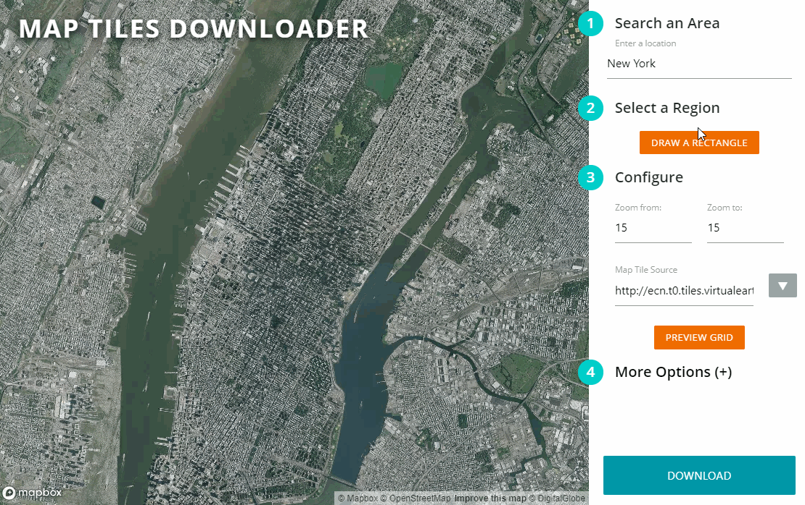

<p align="center">
  <a href="https://www.artacyber.com">
    <picture>
      <source media="(prefers-color-scheme: dark)" srcset="src/UI/brand/lockup-dark.svg">
      
    </picture>
  </a>
</p>

# Arta Map Downloader

**A super easy to use GUI for downloading map tiles, with resume.** By [Arta Cyber Inc.](https://www.artacyber.com), based on [Map Tiles Downloader](https://github.com/AliFlux/MapTilesDownloader) by Ali Ashraf.

<p align="center">
  
</p>

> **Arta Map Downloader** is an enhanced fork of **[Map Tiles Downloader](https://github.com/AliFlux/MapTilesDownloader)** by **[Ali Ashraf (AliFlux)](https://github.com/AliFlux)**, released under the MIT License. All credit for the original idea, UI and downloader goes to him. This fork adds resume, an editable download rectangle and fixes for the slowdown and memory growth on large downloads. See [What's new in this fork](#whats-new-in-this-fork) and [Credits](#credits).

## What's new in this fork

### New features

- **Resume a download.** Stop it, close the tab or kill the server and carry on later: the tiles on disk are the record of what is done, and only missing tiles are fetched again.
- **Open an existing tile folder.** *Resume / open existing folder* lists the folders in `src/output` or takes any absolute path to a tile folder or `.mbtiles` file. Folders made by older versions work too (the region and zooms come from `metadata.json` or from the tiles on disk).
- **Coverage on the map.** The folder's downloaded tiles are drawn on the map with a green (have) / red (missing) overlay, plus a have / missing / total table per zoom level.
- **Editable download rectangle.** Drag a corner or edge to resize it, or the centre dot to move it. The tile estimate, the *Missing: N of M* figure, the table and the overlay update as you drag (about 15 ms per refresh on a 71k-tile folder), so you can grow the map and see exactly which new tiles are needed. Resume then downloads only those.
- **Retry failed.** Tiles that failed are recorded in the manifest and can be retried on their own.
- **`job.json` manifest** written with every download (source, region, zooms, scale, file pattern, failed tiles).
- **Server-side downloads.** The download runs on the server and the browser only polls progress, so closing or reloading the page no longer matters.
- **`--port` and `--host` options** (defaults: `8080`, `127.0.0.1`).

### Performance and memory fixes

- Browser memory stays flat (about 8 MB) instead of climbing to 160+ MB over a 3,000-tile job, and speed no longer drops as the job grows (about 170 tiles/s steady against 102 falling to 31 on the same fake-server test).
- Server memory stays at about 20 MB over a 149,000-tile job.
- Removed: the ever-growing list of requests, one map layer per tile, the log textarea rebuilt on every tile, a polygon intersection per tile, and a base64 copy of every tile sent back to the browser.
- sqlite connections (MBTiles / Repo) are reused and closed instead of one per tile; images and temp files are closed and deleted.
- HTTP connections are reused per download thread, which avoids running out of local ports on very large jobs and saves a TLS handshake per tile.
- Tile requests time out after 20 s and retry with backoff on network errors, 429 and 5xx, honouring `Retry-After`.
- Tiles are written under a temporary name and renamed, so a killed run never leaves a half-written tile; 0-byte files count as missing.

### Behaviour changes

- The server listens on `127.0.0.1` only by default and refuses requests that do not come from localhost. The Dockerfile passes `--host 0.0.0.0`.
- Paths with `..` in the URL no longer serve files outside the UI folder.
- An existing `metadata.json` is never overwritten when resuming.
- Starting a new download still creates a new `{timestamp}` folder; continue an old one through the resume panel.
- Tiles the provider does not have (404) stay "missing", so every resume asks for them again.
- Fixed: Ctrl-click on the map showed X and Y swapped. The progress ring no longer animates (it caused console errors).
- `turf.min.js` and `async.min.js` are no longer loaded by the page.

### Not tested

Real tile providers (testing used a local fake tile server), Docker, stitching, touch dragging, and Python versions other than 3.12.

## So what does it do?

This tiny python based script allows you to download map tiles from Google, Bing, Open Street Maps, ESRI, and other providers. This script comes with an easy to use web based map UI for selecting the area and previewing tiles.

**Just run the script via command line**

```sh
cd src
python server.py
```

Then open up your web browser and navigate to `http://localhost:8080`. The output map tiles will be in the `src/output/{timestamp}/` directory by default.

Options:

```sh
python server.py --port 8090          # different port (default 8080)
python server.py --host 0.0.0.0       # listen on all interfaces (default 127.0.0.1, this machine only)
```

## Requirements

Needs **Python 3.13+** and a modern web browser. Install dependencies with:

```sh
pip install -r requirements.txt
```

| Package | Purpose |
|---------|---------|
| [Pillow](https://pypi.org/project/Pillow/) | Tile scaling (2x/Hi-Res output) |
| [pyvips](https://pypi.org/project/pyvips/) | Tile stitching — memory-efficient image assembly |

On Windows, `pyvips[binary]` bundles the required libvips DLLs automatically. On Linux/macOS, install libvips via your package manager (`apt install libvips` / `brew install vips`) before running pip.

> **Note:** The `cgi` module was removed in Python 3.13. This repo has been updated to use the `email` module as a replacement. Python versions older than 3.13 are not tested with the current code.

## Via Docker

Docker is a pretty simple way to install and contain applications. [Install Docker on your system](https://www.docker.com/products/docker-desktop), then build the image from the included `Dockerfile` and run it (no prebuilt image is published for Arta Map Downloader; the tag below is just a local name):

```sh
docker build -t arta-map-downloader .
docker run -v $PWD/output:/app/output/ -p 8080:8080 -it arta-map-downloader
```

Now open the browser and head over to `http://localhost:8080`. The downloaded maps will be stored in the `output` directory.

## Purpose

In the original author's words: I design map related things as a hobby, and often I have to work with offline maps that require tiles to be stored on my local system. Downloading tiles is a bit of a headache, and the current solutions have user experience issues. So I built this tiny script in a couple of hours to speed up my work.

## Features

- Super easy to use map UI to select region and options
- Multi-threading to download tiles in parallel
- Cross platform, use any OS as long as it has Python and a browser
- Dockerfile available for easy setup
- Supports 2x/Hi-Res/Retina/512x512 tiles by merging multiple tiles
- Supports downloading to file as well as mbtile format
- Select multiple zoom levels in one go
- Ability to ignore tiles already downloaded
- Resume a stopped or interrupted download, or open any existing tile folder and download only what is missing
- Specify any custom file name format
- Supports ANY tile provider as long as the url has `x`, `y`, `z`, or `quad` in it
- Base map uses OpenStreetMap (no API key required)
- **Built-in tile stitcher** — assembles all downloaded tiles into a single GeoTIFF with one click, using [libvips](https://www.libvips.org/) for memory-efficient processing of very large images

## Tile Sources

The following providers are available from the dropdown and have been verified working:

| Provider | Type | Notes |
|----------|------|-------|
| Bing Maps | Road | |
| Bing Maps Satellite | Satellite | |
| Bing Maps Hybrid | Satellite + labels | |
| Google Maps | Road | Unofficial endpoint, may be rate-limited |
| Google Maps Satellite | Satellite | Unofficial endpoint, may be rate-limited |
| Google Maps Hybrid | Satellite + labels | Unofficial endpoint, may be rate-limited |
| Google Maps Terrain | Terrain | Unofficial endpoint, may be rate-limited |
| Open Street Maps | Road | |
| Open Cycle Maps | Cycling | |
| ESRI World Imagery | Satellite | Best quality, up to zoom 19-20, free, no key required |
| Carto Light | Road (minimal) | |

**For the highest quality satellite imagery**, use **ESRI World Imagery** at zoom level 18 or 19.

## Zoom Levels

Zoom level controls the detail and tile count. Each level up has 4× more tiles than the previous.

| Zoom | Detail level |
|------|-------------|
| 1–5 | Country / continent |
| 10–12 | City |
| 15–16 | Street (default) |
| 18–19 | Building / maximum detail |

Set **Zoom from** and **Zoom to** to the same value to download only that level. Set a range to download multiple levels at once (useful for maps that need to work at different scales).

## Output

Tiles are saved to `src/output/{timestamp}/` by default, in `{z}/{x}/{y}.png` folder structure. Both the output directory and file name format can be customised under **More Options** in the UI.

## Resuming a Download

Downloads run on the server, so the browser stays light even for hundreds of thousands of tiles. The tiles on disk are the source of truth: a stopped download, a closed browser tab or a killed server can all be resumed, and only the missing tiles are fetched again.

Every download writes a `job.json` manifest into its output folder (for MBTiles/Repo it sits beside the file as `tiles.mbtiles.job.json`). It records the tile source, region, zoom levels, scale, file pattern, and the list of tiles that failed.

**To resume:**
1. Click **Resume / open existing folder** at the top of the sidebar
2. Pick a folder from `src/output`, or type the absolute path of any tile folder or `.mbtiles` file and click **Open**
3. The map shows the folder's downloaded tiles, plus a coverage overlay (green = have, red = missing) at the zoom picked under the table. The table lists have / missing / total per zoom
4. Check the source URL and zooms. The region is the orange rectangle on the map: drag a corner or an edge to resize it, or the centre dot to move it. The table, the *Missing: N of M* figure and the coverage overlay follow as you drag, so you can grow the map and see the new area turn red. Then click **Resume**: only the missing tiles inside the rectangle are downloaded. If everything is already there it says *Nothing to resume*. `job.json` keeps the latest rectangle
5. **Retry failed** downloads only the tiles recorded as failed in the manifest

Folders without a `job.json` (made by older versions) still work: the region and zoom levels come from `metadata.json`, or are inferred from the tiles on disk, and you fill in the source URL. Empty (0-byte) tile files count as missing; tick *Check tile files for truncation* to also catch cut-off PNG/JPEG files (slower, it reads every file). Tiles are written under a temporary name and renamed, so a killed run cannot leave a half-written tile behind.

Tile downloads time out after 20 seconds and are retried up to 3 times with backoff on network errors, 429 and 5xx responses; a `Retry-After` header from the tile server pauses the whole download for that long.

## Stitching Tiles into a Single Image

The downloader includes a built-in stitcher powered by [libvips](https://www.libvips.org/). Unlike Photoshop or Pillow, libvips processes images in strips rather than loading everything into RAM, so it handles multi-gigapixel outputs without running out of memory.

**To use:**
1. Check **Stitch tiles into image after download** (visible above the Download button — only enabled for Directory output type)
2. Start the download as normal
3. Once all tiles have downloaded, stitching begins automatically
4. Progress is shown in the log panel; the button shows **STITCHING...** while it runs
5. Output is saved alongside the tile folders as `stitched_z{zoom}.tif` — one file per zoom level

The output is a tiled, deflate-compressed TIFF compatible with GIS tools (QGIS, GDAL, ArcGIS) and image editors. For zoom ranges, a separate TIFF is produced for each zoom level.

> **Note:** Stitching is only available when **Output type** is set to **Directory** (the default). MBTiles and Repo formats store tiles internally and don't produce individual image files to stitch from.

## Credits

- Original project: [AliFlux/MapTilesDownloader](https://github.com/AliFlux/MapTilesDownloader) by [Ali Ashraf](http://aliashraf.net) (MIT License). The base map UI, tile providers list, downloader, stitcher and Docker setup come from it.
- Resume, editable rectangle, performance and memory work in this fork: Arta Cyber Inc.

## Important Disclaimer

Downloading map tiles is subject to the terms and conditions of the tile provider. Some providers such as Google Maps have restrictions in place to avoid abuse, therefore before downloading any tiles make sure you understand their TOCs. We recommend not using Google, Bing, and ESRI tiles in any commercial application without their consent.

## Arta Cyber Inc.

Arta Map Downloader is maintained by Arta Cyber Inc. For releases, announcements and our other work, visit [www.artacyber.com](https://www.artacyber.com).

## License

This software is released under the [MIT License](LICENSE). Please read LICENSE for information on the
software availability and distribution.

Copyright (c) 2020 [Ali Ashraf](http://aliashraf.net)
Copyright (c) 2026 [Arta Cyber Inc.](https://www.artacyber.com) (modifications in Arta Map Downloader), under the same MIT License.
